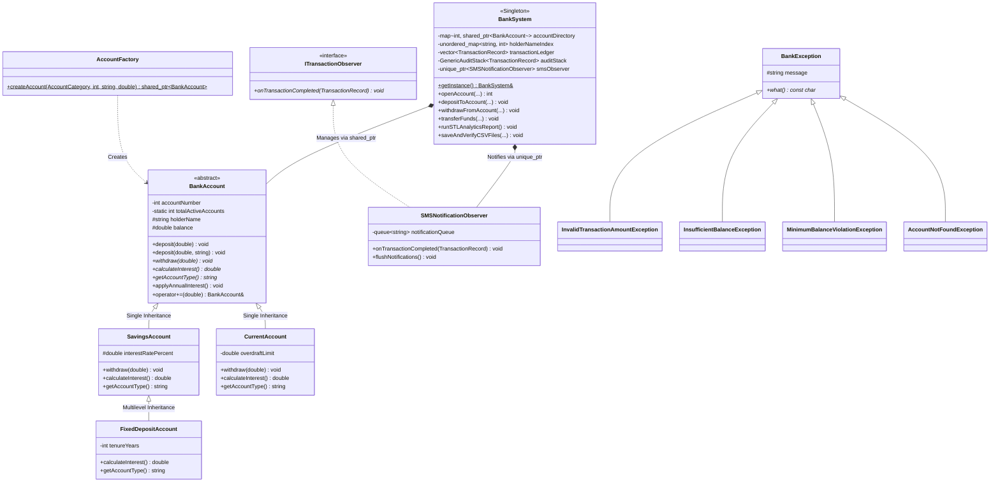

# Object-Oriented Programming using C++ Laboratory (`E0054B`) — Practicals 1 to 10 & Mini Project (11)

**Institution:** Ajeenkya DY Patil University (ADYPU)  
**Courses:** Object Oriented Programming (`E0053A`) & Object Oriented Programming using C++ Laboratory (`E0054B`)  
**Language:** C++ (Strictly aligned with Units 1 to 5 of the ADYPU Syllabus)

---

## Repository Structure (All Practicals & Mini Project in Separate Files)

| S.N. | Source File | Experiment / Practical Description (As per Syllabus) | Syllabus Unit |
| :---: | :--- | :--- | :---: |
| **1** | [`Practical_01_DataTypes_Operators_IO.cpp`](./Practical_01_DataTypes_Operators_IO.cpp) | Set up a GitHub repository. Write a C++ program to demonstrate data types, constants (`const`, `constexpr`), variables, operators, `::`, `new`/`delete`, `auto`, range-based `for`, and console I/O. | Unit 1 |
| **2** | [`Practical_02_Class_Hierarchy_Access_Specifiers.cpp`](./Practical_02_Class_Hierarchy_Access_Specifiers.cpp) | Design and implement a class hierarchy for a real-world entity (`BankAccount` & `Vehicle`). Demonstrate access specifiers (`private`, `protected`, `public`), member functions (`::`), static members, and `friend` functions. | Unit 1 & 2 |
| **3** | [`Practical_03_Constructors_Rule_Of_5_RAII.cpp`](./Practical_03_Constructors_Rule_Of_5_RAII.cpp) | Implement a class demonstrating all constructor types (Default, Parameterized, Copy, Move). Apply the **Rule of 5**, RAII (`unique_ptr`, `shared_ptr`, `weak_ptr`), and verify absence of memory leaks. | Unit 2 |
| **4** | [`Practical_04_Single_And_Multilevel_Inheritance.cpp`](./Practical_04_Single_And_Multilevel_Inheritance.cpp) | Implement Single and Multilevel Inheritance for a university management scenario (`Person` → `Student` → `GraduateStudent`). | Unit 3 |
| **5** | [`Practical_05_Runtime_Polymorphism_Shape_Hierarchy.cpp`](./Practical_05_Runtime_Polymorphism_Shape_Hierarchy.cpp) | Demonstrate runtime polymorphism using `virtual` functions and an abstract base class. Implement a `Shape` hierarchy (`Circle`, `Rectangle`, `Triangle`) with an `area()` method. | Unit 3 |
| **6** | [`Practical_06_Compile_Time_Polymorphism_Overloading.cpp`](./Practical_06_Compile_Time_Polymorphism_Overloading.cpp) | Implement compile-time polymorphism: function overloading and operator overloading (`+`, `-`, `*`, `~`, `==`, `<<`) for `Complex` Number and `Matrix2x2` classes. | Unit 3 |
| **7** | [`Practical_07_Generic_Stack_Queue_Templates.cpp`](./Practical_07_Generic_Stack_Queue_Templates.cpp) | Write generic `GenericStack<T>` and `GenericQueue<T>` classes using C++ templates. Test with `int`, `float`, and `std::string`. | Unit 4 |
| **8** | [`Practical_08_STL_Containers_And_Algorithms.cpp`](./Practical_08_STL_Containers_And_Algorithms.cpp) | Use STL containers (`vector`, `map`, `unordered_map`) and algorithms (`sort`, `find_if`, `transform`, `accumulate`, `for_each`) with lambda expressions to process a student marks dataset. | Unit 4 |
| **9** | [`Practical_09_Custom_Exception_Hierarchy_Banking.cpp`](./Practical_09_Custom_Exception_Hierarchy_Banking.cpp) | Create a custom exception hierarchy (`BankingException`). Write a program that throws and catches specific exceptions for a banking transaction scenario. | Unit 5 |
| **10** | [`Practical_10_CSV_File_IO_Student_Records.cpp`](./Practical_10_CSV_File_IO_Student_Records.cpp) | Implement a CSV file reader/writer using file I/O (`fstream`). Store and retrieve student records ([`students_records.csv`](./students_records.csv)) and use file pointers (`seekg`, `seekp`, `tellg`, `tellp`). | Unit 5 |
| **11** | [`Practical_11_Mini_Project_Bank_Account_Management_System.cpp`](./Practical_11_Mini_Project_Bank_Account_Management_System.cpp) | **MINI PROJECT:** Console-based **Bank Account Management System** in C++ applying OOP principles, Design Patterns (Singleton, Factory, Observer), Templates, STL, Custom Exceptions, and CSV File I/O ([`bank_accounts.csv`](./bank_accounts.csv), [`bank_transactions.csv`](./bank_transactions.csv)). | Units 1–5 |

---

## How to Compile and Run Any Practical

```bash
# Practical 1
g++ -Wall -Wextra Practical_01_DataTypes_Operators_IO.cpp -o practical1 && ./practical1

# Practical 2
g++ -Wall -Wextra Practical_02_Class_Hierarchy_Access_Specifiers.cpp -o practical2 && ./practical2

# Practical 3
g++ -Wall -Wextra Practical_03_Constructors_Rule_Of_5_RAII.cpp -o practical3 && ./practical3

# Practical 4
g++ -Wall -Wextra Practical_04_Single_And_Multilevel_Inheritance.cpp -o practical4 && ./practical4

# Practical 5
g++ -Wall -Wextra Practical_05_Runtime_Polymorphism_Shape_Hierarchy.cpp -o practical5 && ./practical5

# Practical 6
g++ -Wall -Wextra Practical_06_Compile_Time_Polymorphism_Overloading.cpp -o practical6 && ./practical6

# Practical 7
g++ -Wall -Wextra Practical_07_Generic_Stack_Queue_Templates.cpp -o practical7 && ./practical7

# Practical 8
g++ -Wall -Wextra Practical_08_STL_Containers_And_Algorithms.cpp -o practical8 && ./practical8

# Practical 9
g++ -Wall -Wextra Practical_09_Custom_Exception_Hierarchy_Banking.cpp -o practical9 && ./practical9

# Practical 10
g++ -Wall -Wextra Practical_10_CSV_File_IO_Student_Records.cpp -o practical10 && ./practical10

# Practical 11 (Mini Project - Bank Account Management System)
g++ -Wall -Wextra Practical_11_Mini_Project_Bank_Account_Management_System.cpp -o bank_system && ./bank_system
```

---

## Practical 11 (Mini Project): Bank Account Management System — Syllabus Architecture & UML Diagram

### Syllabus Mapping (Units 1 to 5)
* **Unit 1 (OOP & Modern C++ Foundations):** Encapsulation, Abstraction, Inheritance, Polymorphism, `const`, `constexpr`, `auto`, range-based `for`, `nullptr`, scope resolution `::`, formatted console I/O.
* **Unit 2 (Classes, Objects & Memory Management):** Access specifiers (`private`, `protected`, `public`), **Rule of 5** (`TransactionRecord`), constructor delegation, initializer lists, `static` members, `friend` function (`operator<<`), RAII smart pointers (`std::shared_ptr`, `std::unique_ptr`).
* **Unit 3 (Inheritance, Polymorphism & Design Patterns):** Abstract base class `BankAccount`, Single/Hierarchical Inheritance (`SavingsAccount`, `CurrentAccount`), Multilevel Inheritance (`BankAccount` → `SavingsAccount` → `FixedDepositAccount`), Function Overloading (`deposit`), Operator Overloading (`+=`, `==`, `<<`), and **Singleton** (`BankSystem`), **Factory Method** (`AccountFactory`), and **Observer** (`SMSNotificationObserver`) design patterns.
* **Unit 4 (Generic Programming & STL):** Class template (`GenericAuditStack<T>`), Function template (`printMetricRow<T>`), STL Containers (`vector`, `map`, `unordered_map`, `queue`), STL Algorithms (`sort`, `find_if`, `accumulate`, `for_each`) with Lambdas.
* **Unit 5 (Exception Handling & File I/O):** Custom Exception Hierarchy (`BankException` derivatives) with `noexcept` and `try-catch-throw`; CSV File I/O (`fstream`) with random-access file pointers (`seekg`, `seekp`, `tellg`, `tellp`).

### UML Class Diagram

